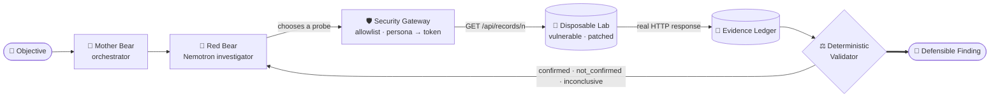

<div align="center">

# 🐻 Red Bears

### The AI security investigator that *proves* the flaw — it doesn't just talk about it.

Red Bears points an **NVIDIA Nemotron** agent at a disposable, intentionally vulnerable app,
lets it **choose its own probes**, captures the **real HTTP evidence**, and has a
**deterministic validator** — not the model — decide whether the vulnerability is confirmed.
Then it re-runs the exact same investigation against the **patched** build and reports what changed.

<br/>

[](https://nebius.com/services/token-factory/nemotron)
[](https://nebius.com/services/token-factory/nemotron)


</div>

---

## 🎬 See it in action

<div align="center">

<video src="https://github.com/Martysunshine/redbears/raw/main/docs/demo/red-bears-demo.mp4" controls muted width="80%"></video>

**▶ [Watch the demo clip](docs/demo/red-bears-demo.mp4)**  ·  **🔴 [Watch the full live-pentest walkthrough on Loom](https://www.loom.com/share/31e9ed4c9e2641958d0654ffd38fe813)**

<sub>(If the player above doesn't render inline on github.com, use the links.)</sub>

</div>

---

## The problem

An LLM that *says* "this endpoint looks vulnerable to IDOR" is worthless to a security team.
`HTTP 200` alone proves nothing. A chatbot will happily hallucinate a finding, a CVE, or a
screenshot. You cannot put that in a report.

## What Red Bears does differently

> **An objective goes in. A defensible, evidence-backed verdict comes out — and the model is never allowed to be the one who says "confirmed."**

1. **The agent chooses the actions.** Nemotron selects which probe to run against the target. Real model-selected tool calls, a recorded trace — not a hardcoded script.
2. **A gateway, not the model, holds the keys.** The agent asks to probe `alice`/`bob`; the gateway maps the persona to a local demo token and makes the request. The model never sees a credential and can never choose the destination host.
3. **Every request/response is persisted as immutable evidence.** Method, path, persona, status, owner — captured to an evidence ledger with an `evidence_id`.
4. **A deterministic validator decides the verdict.** `confirmed` requires a genuine cross-user response *with a known owner* **and** a working same-user control. Missing or contradictory evidence ⇒ `inconclusive`, never a false `confirmed`.
5. **Then it retests the patch.** The operator flips the lab to `patched` and the same investigation runs again. A `403` where there used to be a disclosure is the proof the fix landed.

---

## How it works



The journey: **Objective → Mother Bear delegates → Red Bear selects approved probes → gateway executes → real response evidence → independent validator → finding → operator switches to the patched lab → agent retests → changed verdict.**

---

## The live demo: Broken Object Level Authorization (IDOR)

A tiny FastAPI target seeds two records and two identities:

| Record | Owner |
|---|---|
| `101` | alice |
| `202` | bob   |

The **same codebase** runs in two modes. Here's the whole story in one table — this is exactly what the agent observes and the validator checks:

| Authenticated request | 🔓 vulnerable | 🔒 patched |
|---|---|---|
| bob → `202` (his own) | `200` · `owner=bob` | `200` · `owner=bob` |
| alice → `101` (her own) | `200` · `owner=alice` | `200` · `owner=alice` |
| **bob → `101` (not his)** | **`200` · `owner=alice`** 🚨 | **`403`** · nothing leaks ✅ |
| missing / invalid token | `401` | `401` |
| any persona → unknown id | `404` | `404` |

The red cell is the vulnerability. The green cell is the proof it's fixed. The validator only
writes `confirmed` when it has seen **both** the cross-user disclosure *and* a passing same-user
control — so the finding stands up to scrutiny.

---

## Quick start

**The disposable lab** (no Docker required, loopback only):

```bash
python -m venv lab/.venv
lab/.venv/Scripts/pip install -r lab/requirements.txt   # Windows
# lab/.venv/bin/pip install -r lab/requirements.txt       # macOS / Linux
python -m lab.run_local                                  # vulnerable :18081  ·  patched :18082
```

```bash
curl http://127.0.0.1:18081/health    # {"ok":true,"mode":"vulnerable"}
python -m lab.selfcheck               # runs the whole matrix, writes lab/artifacts/last_selfcheck.json
```

Full lab docs, tokens and the acceptance matrix: **[lab/README.md](lab/README.md)**.

**The Oyster security copilot** (local RAG + chat + evidence reranking that powers the research side) lives in **[oyster/](oyster/README.md)** — a fully local FastAPI + Next.js + Ollama assistant over a 118k-chunk curated security knowledge base, with optional **Nemotron evidence reranking** and a live Hermes pentest panel.

---

## Why it's safe to run

Red Bears is safe **by construction**, and it must stay that way:

- 🔒 **Loopback only.** Every service binds `127.0.0.1`. Nothing is ever exposed off the machine.
- 👀 **Read-only target.** The lab exposes only `GET`. There are no write or delete routes.
- 🎭 **Synthetic data.** Two fake records, no secrets, nothing real to protect.
- 🚫 **The model can't pick the target.** The gateway owns the host, the allowlist, and the tokens. Out-of-scope requests are refused and logged — never silently executed.
- 🧾 **Everything is logged** (method, path, persona, status, mode, request id) — **never** a token value.
- ⚖️ **Mocks are never shown as results.** Development mocks are labelled; final demo evidence is real and reproducible.

> Built and tested for an **authorized** internal engagement against a **disposable local lab**.
> Do not point any client at anything but that lab.

---

## The team

A three-person [Red Orca](https://redorca.tech) crew at the Nebius × NVIDIA hackathon in Berlin:

| | Owns |
|---|---|
| **Pratika** | Nemotron / Nebius integration · Mother Bear orchestration · the Red Bear investigator and its tool loop |
| **Martin** | The disposable vulnerable lab · the two identities · vulnerable/patched modes · health checks and resets |
| **Emre** | The security tool gateway · allowlist and safeguards · independent evidence validation · the end-to-end demo |

---

<div align="center">

**Red Bears** — *evidence, not vibes.*

Runs locally. Proves locally. Nothing leaves the box.

<sub>Hackathon prototype / development checkpoint — see [docs/CHECKPOINT.md](docs/CHECKPOINT.md) and [docs/SECURITY.md](docs/SECURITY.md) for exactly what is and isn't implemented.</sub>

</div>
